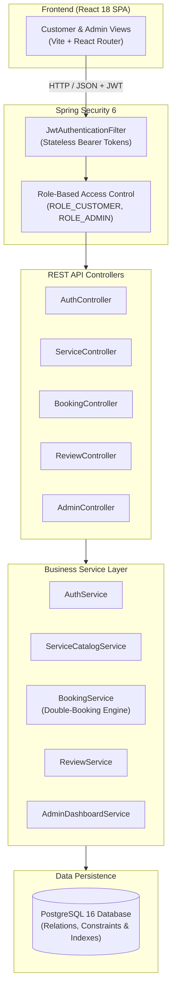
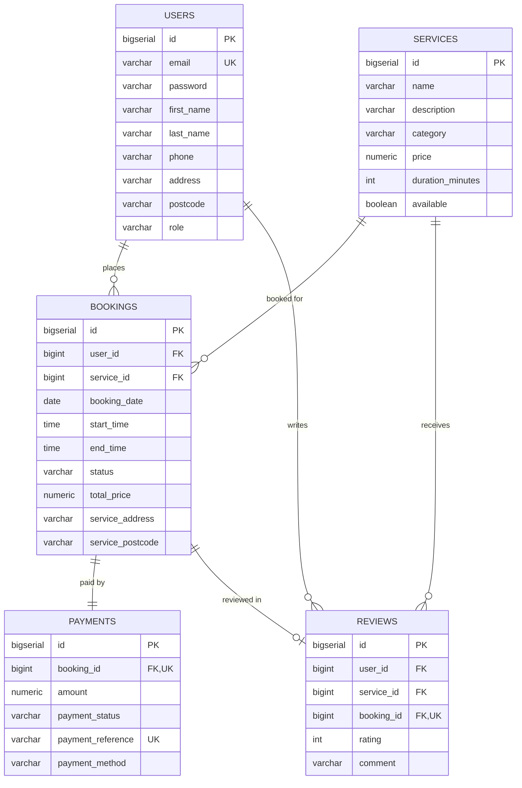

# UK Service Booking & Order Management Platform

[](https://github.com/sricharanperala111-eng/uk-service-booking-platform/actions)
[](https://www.oracle.com/java/)
[](https://spring.io/projects/spring-boot)
[](https://www.postgresql.org/)
[](https://react.dev/)
[](https://www.docker.com/)

A production-style full-stack service booking and order management platform built with **Java 17, Spring Boot 3, Spring Security, JWT, PostgreSQL, and React**. Designed to demonstrate secure backend development, relational database modeling, business rule validation, automated testing with JUnit 5 & Mockito, Docker containerisation, and CI/CD automation tailored for UK Java and Full-Stack Developer roles.

---

## 1. Business Context & Problem Statement

In the UK domestic maintenance sector (plumbing, heating, electrical, cleaning, and appliance repair), homeowners and property managers frequently face:
- Uncertainty in pricing with unexpected call-out fees.
- Scheduling friction, double-booked technicians, and manual phone confirmations.
- Lack of verified reviews tied to genuine completed work.

### The Solution:
A centralised marketplace providing:
- **Upfront transparent pricing in GBP (£)** with no hidden fees.
- **Real-time double-booking prevention**: Dynamic technician scheduling engine preventing overlapping bookings for the same service.
- **Verified customer reviews**: Only customers with completed service bookings can rate and review tradespeople.
- **Admin command centre**: Operational dashboard tracking revenue, order lifecycles, service catalogs, and customer metrics.

---

## 2. Technology Stack

| Layer | Technology |
| :--- | :--- |
| **Backend** | Java 17, Spring Boot 3.3.4, Spring MVC, Spring Data JPA, Hibernate 6, Spring Security 6 |
| **Authentication** | JWT (JSON Web Tokens via JJWT 0.12.6), BCrypt password hashing |
| **Database** | PostgreSQL 16 (Production / Docker), H2 In-Memory (Zero-config local development) |
| **Frontend** | React 18, Vite, React Router DOM 6, Lucide React icons, CSS3 Design System |
| **API Docs** | OpenAPI 3.0 / Swagger UI (`springdoc-openapi`) |
| **Testing** | JUnit 5, Mockito, AssertJ |
| **DevOps** | Docker, Docker Compose, Nginx (Alpine), GitHub Actions CI/CD |

---

## 3. Architecture Overview



---

## 4. Database Design (Entity-Relationship)



---

## 5. Core Business Logic & Security

1. **Double-Booking Prevention Algorithm**:
   When booking a service, the system computes the completion time:
   $$\text{endTime} = \text{startTime} + \text{service.durationMinutes}$$
   It executes an indexed overlap query:
   ```sql
   SELECT COUNT(b) > 0 FROM Booking b
   WHERE b.service.id = :serviceId
     AND b.bookingDate = :bookingDate
     AND b.status != 'CANCELLED'
     AND (b.startTime < :newEndTime AND b.endTime > :newStartTime)
   ```
   If an overlap is detected, an informative `409 Conflict` response is returned.

2. **Order Lifecycle State Machine**:
   Enforces valid transitions:
   - `PENDING` $\rightarrow$ `CONFIRMED` or `CANCELLED`
   - `CONFIRMED` $\rightarrow$ `IN_PROGRESS` or `CANCELLED`
   - `IN_PROGRESS` $\rightarrow$ `COMPLETED` or `CANCELLED`
   - Completed orders cannot be cancelled; cancellations automatically trigger simulated refund processing.

3. **Data Ownership & Authorisation**:
   - Customers can only query, view, and cancel their own bookings.
   - Only administrators have permission to dispatch orders, manage trade services, and access analytics.

---

## 6. Pre-Seeded Evaluation Credentials

When running the platform, demo accounts are pre-loaded:

| Role | Email | Password | Permissions |
| :--- | :--- | :--- | :--- |
| **Administrator** | `admin@ukservices.co.uk` | `AdminPass123!` | Full dashboard, manage services, manage all bookings |
| **Customer** | `john.smith@example.co.uk` | `CustomerPass123!` | Browse catalog, book services, view own orders, leave reviews |
| **Customer 2** | `emily.davies@example.co.uk` | `CustomerPass123!` | Alternative customer account with historical bookings |

*Note: The React login page includes a 1-click "Demo Credentials" toggle for immediate testing.*

---

## 7. Quick Start Instructions

### Option A: Run with Docker Compose (Recommended)

Requires Docker Desktop installed and running:
```bash
# Clone the repository
git clone https://github.com/sricharanperala111-eng/uk-service-booking-platform.git
cd uk-service-booking-platform

# Build and start PostgreSQL, Backend, and Frontend containers
docker compose up --build
```
- **Frontend**: `http://localhost:3000`
- **Backend API**: `http://localhost:8080/api`
- **Swagger UI**: `http://localhost:8080/swagger-ui.html`
- **PostgreSQL**: `localhost:5432` (db: `uk_service_db`, user: `postgres`, pass: `postgres`)

---

### Option B: Run Locally Without Docker (Zero-Config)

The application includes an embedded in-memory H2 database profile with PostgreSQL compatibility mode, allowing instant startup without any external dependencies.

#### 1. Start Spring Boot Backend:
```bash
cd backend
mvn spring-boot:run
```
*(Runs on `http://localhost:8080` with pre-seeded UK services and demo users)*

#### 2. Start React Frontend:
```bash
cd frontend
npm install
npm run dev
```
*(Runs on `http://localhost:3000` with automated proxy to the backend)*

---

## 8. Running Automated Tests

Run the full JUnit 5 & Mockito test suite:
```bash
cd backend
mvn test
```

### Verified Test Cases Include:
- Double-booking conflict detection (`BookingConflictException`).
- Unavailable service rejection (`BadRequestException`).
- Successful booking & payment creation.
- Customer record ownership validation (`AccessDeniedException`).
- Invalid status transition enforcement (`InvalidStatusTransitionException`).
- Duplicate email registration rejection.
- Password hashing and JWT generation verification.

---

## 9. CI/CD Pipeline (GitHub Actions)

The `.github/workflows/ci.yml` pipeline triggers automatically on pushes and pull requests:
1. **Backend Job**: Sets up Temurin JDK 17 with an ephemeral PostgreSQL service container, runs the JUnit test suite, and packages the executable JAR artifact.
2. **Frontend Job**: Sets up Node.js 20, runs clean install (`npm ci`), builds the production SPA bundle, and verifies asset chunk generation.
3. **Docker Verification Job**: Builds production multi-stage Docker images for both backend and frontend to ensure container deployment readiness.

---

## 10. Repository Structure

```
uk-service-booking-platform/
├── .github/
│   └── workflows/
│       └── ci.yml               # GitHub Actions CI/CD pipeline
├── backend/
│   ├── src/
│   │   ├── main/java/com/ukservices/booking/
│   │   │   ├── config/          # Spring Security, JWT, OpenAPI & Seeder
│   │   │   ├── controller/      # REST API Controllers
│   │   │   ├── dto/             # Request & Response DTOs
│   │   │   ├── entity/          # JPA Entities & Enums
│   │   │   ├── exception/       # Global Exception Handler & Custom Errors
│   │   │   ├── repository/      # Spring Data JPA Repositories
│   │   │   └── service/         # Business Logic, State Machine & Calculations
│   │   └── resources/
│   │       └── application.yml  # Multi-profile configurations (local/postgres)
│   ├── Dockerfile               # Multi-stage Java 17 container build
│   └── pom.xml                  # Maven dependencies & plugins
├── frontend/
│   ├── src/
│   │   ├── components/          # Reusable UI components (Navbar, Modals, Badges)
│   │   ├── context/             # AuthContext (JWT & state persistence)
│   │   ├── pages/               # Customer & Admin pages
│   │   └── services/            # Fetch API client with JWT interceptor
│   ├── Dockerfile               # Multi-stage React + Nginx container build
│   ├── nginx.conf               # Nginx reverse proxy & SPA router
│   ├── package.json
│   └── vite.config.js
├── database/
│   └── init.sql                 # PostgreSQL DDL schema & UK seed data
├── docs/
│   ├── ARCHITECTURE.md          # Architectural blueprints & diagrams
│   ├── DATABASE_DESIGN.md       # Relational models & index details
│   ├── API_DOCUMENTATION.md     # OpenAPI / Swagger endpoint contracts
│   └── CV_PORTFOLIO_GUIDE.md    # UK job-market positioning & interview prep
├── docker-compose.yml           # Full-stack container orchestration
├── .gitignore
└── README.md                    # Project documentation
```

---

## 11. Author & Portfolio Context

- **Developer**: Sri Charan
- **Target Roles**: UK Java Software Developer / Backend Developer / Full-Stack Developer
- **Design Philosophy**: Clean architecture, strong business invariants, transactional integrity, and containerised deployments.
