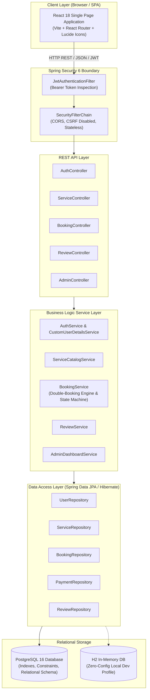
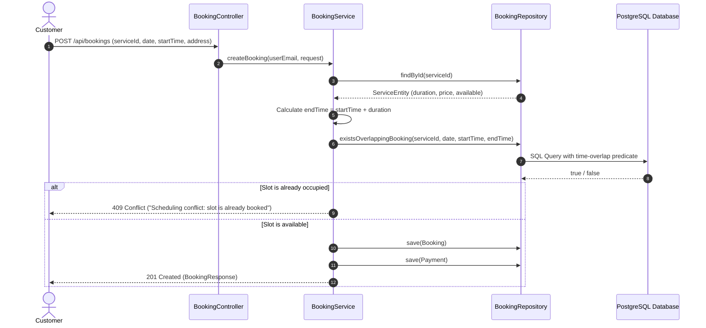
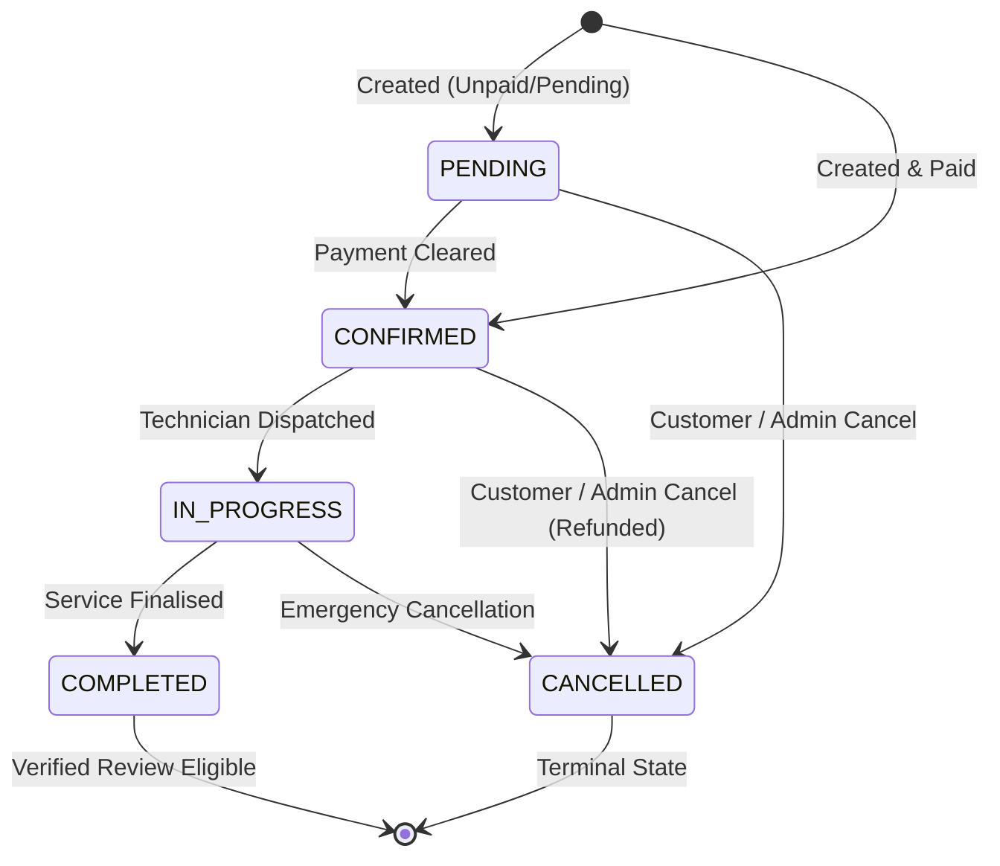

# UK Service Booking & Order Management Platform - Architecture Documentation

## 1. System Architecture Overview

The platform is designed as a **production-grade modular monolith**, balancing clean architectural separation of concerns with operational simplicity. It follows the standard enterprise Java architectural layers:

---

## 2. Request & Authentication Flow

1. **Authentication**: The user logs in via `POST /api/auth/login`. The server verifies credentials against BCrypt-hashed passwords in the database and generates a cryptographically signed HMAC-SHA256 JWT containing `userId`, `email`, and `role` (`ROLE_CUSTOMER` or `ROLE_ADMIN`).
2. **Authorization**: Subsequent requests supply the token via the `Authorization: Bearer <token>` header. `JwtAuthenticationFilter` validates the signature and populates the `SecurityContextHolder`.
3. **Role-Based Access Control**:
   - Public: `/api/auth/**`, `GET /api/services/**`, OpenAPI Docs (`/swagger-ui/**`).
   - Customer: `/api/bookings/**`, `/api/reviews/**`.
   - Admin: `/api/admin/**`, `POST/PUT/DELETE /api/services/**`.

---

## 3. Double-Booking Prevention & Concurrency Engine

The core scheduling conflict algorithm ensures technician slots cannot be reserved multiple times:

The overlap condition is evaluated as:
$$\text{Existing Booking} \cap \text{Requested Slot} \neq \emptyset \iff (b.\text{startTime} < \text{newEndTime}) \land (b.\text{endTime} > \text{newStartTime})$$
Bookings marked with `BookingStatus.CANCELLED` are excluded from the conflict evaluation.

---

## 4. Booking Lifecycle State Machine

Orders adhere to strict lifecycle transitions:

